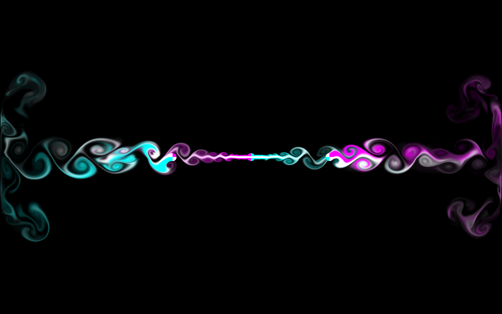
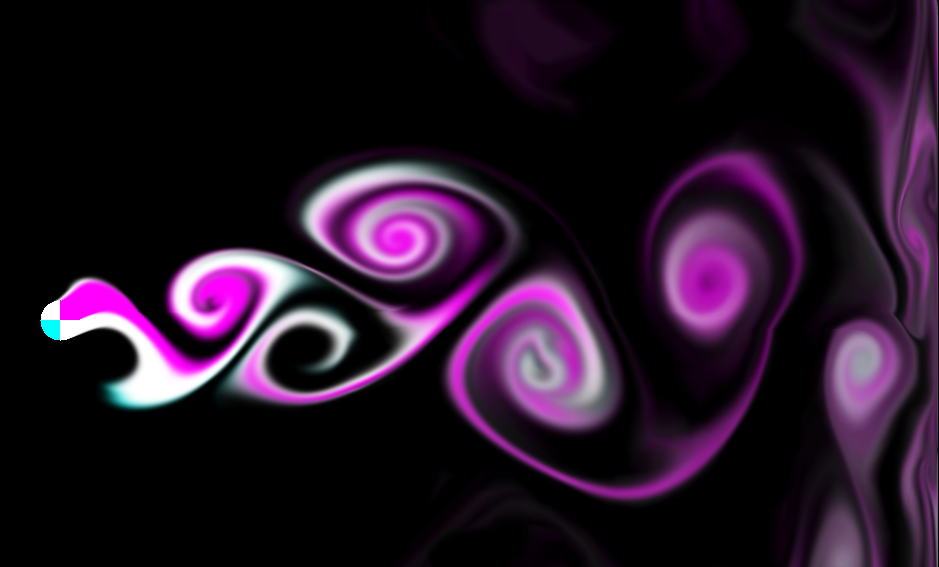
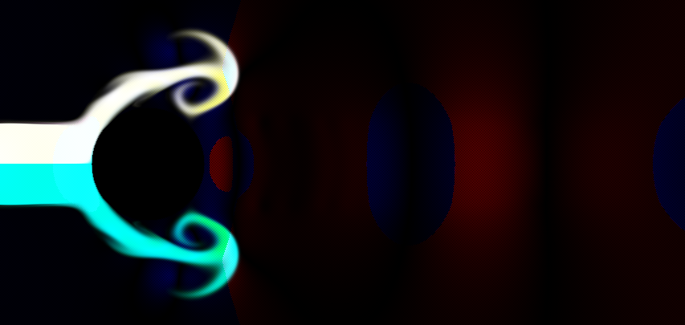
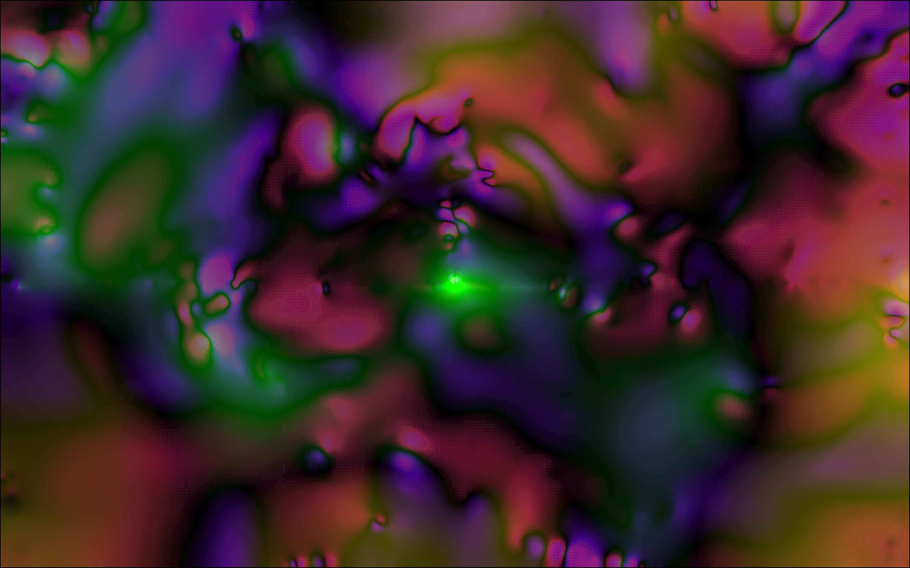

# Smoke Simulation
A 2D Eulerian fluid simulation. More information on how it works can be found [here](https://www.youtube.com/watch?v=Q78wvrQ9xsU&t=242s)

## Build
Update the GCC path inside the `build.bat` or `build.sh`. The current script assumes GCC is installed at `C:/mysys64/ucrt/bin/gcc.exe`. You must also pass in the CMake files for GLFW inside the script, which currently assumes are at `C:/glfw-mingw/lib/cmake/glfw3`. Then, call either `build.bat` or `build.sh` at the root level.

## Features
The phenomenon called **Vortex Shedding** can be seen during simulation. Vortex shedding happens when smoke is obstructed in some way, and has to move around the object.

The reason why this happens is because fast moving fluid meet an obstruction, some parts of the fluid slow down more than the other part. This causes a pressure difference, with lower pressure on the slower side. This then causes the faster moving fluid to curl towards the slower moving fluid, as fluid tends towards low pressure zones in order to balance out the pressure field.

This can be seen when viewing the smoke and pressure map together:

Where the two layers curl towards the spherical obstruction, there is a blue zone of low pressure.

## Cool Visuals

Check out the fragment shader at `src/shaders/shader.frag` to make interesting visuals. For instance, here is an image of a mix between the pressure and divergence maps using the same setup as the screenshot above:

## Plans for the Future
I'm planning on pushing this project into the third dimension, as well as adding temperature, bouyancy, and volumetric shading to make some cool clouds!

## Contact
If you want to hear more about what I'm working on, reach out to me at on [LinkedIn](https://www.linkedin.com/in/henryzhang9000/).
